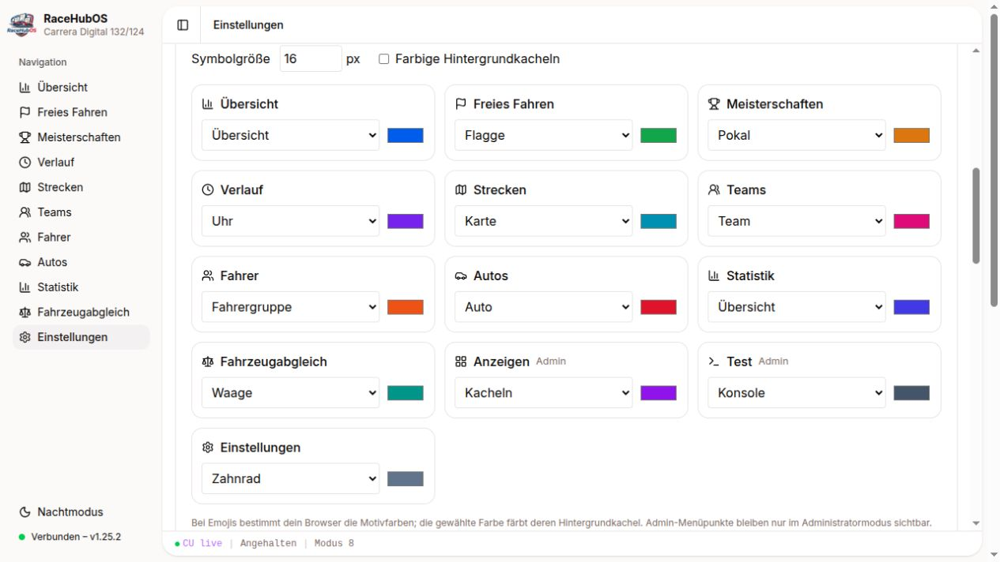

# Carrera integration branch

This branch combines the local Carrera extensions with upstream RaceHubOS **1.25.2**. The fork’s `main` branch mirrors [Anselme’s original](https://github.com/AnselmeSDR/RaceHubOS). The upstream version number and changelog remain unchanged.

The combined branch is for using the extensions together. Contributions to upstream remain separate, topic-specific pull requests following CONTRIBUTING.md. This branch is not a combined upstream pull request.

Additional functionality includes German UI improvements, Linux Bluetooth/CU recovery, Piper voices, car catalogues and scale handling, Cockpit-XP imports, race-screen customization, navigation customization with reset to the original icons, configurable racing sounds, sector and pit information, and the optional track planner.

## Screenshots

The gallery shows this integration build with the original monochrome navigation icons. All names and race results are synthetic demo data. No installation databases or personal images are distributed.

Create a fresh, isolated demo database with Node 22 after installing dependencies:

```sh
node scripts/screenshots/prepare-demo.mjs /tmp/racehubos-screenshot-demo
```

The script refuses to overwrite an existing database. Start the backend with DATABASE_URL pointing to that directory’s test.db and a separate PORT. Connect only the SIMULATOR device for screenshots. Never point this fixture at an installation database.



## Existing lint debt

The initial integration snapshot is recorded in `local-carrera/integration-baseline.json`. The check compares changed files with both upstream and this public ancestor so inherited extension warnings remain distinguishable from newly introduced problems. This baseline is for the integration branch; topical upstream pull requests must satisfy upstream checks independently.
